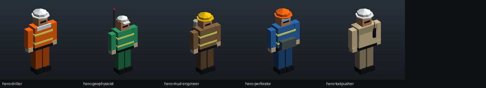
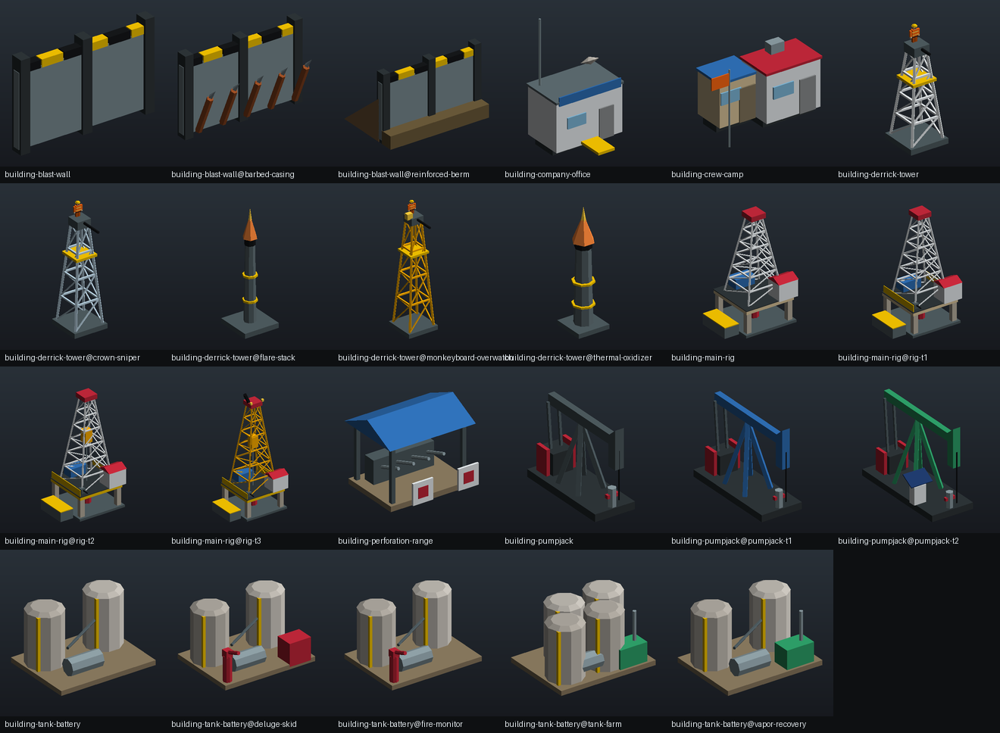
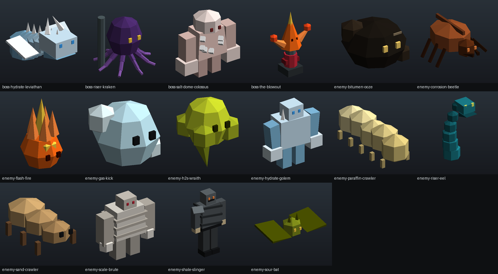

# Rigfall

**Build by day. Defend the rig by night.**

Rigfall is a minimalist strategy and hack-and-slash game set in the oil patch. You play a drilling engineer who builds up a well site by day (pumpjacks, tank batteries, derrick towers, blast walls and crew buildings on fixed slots) and fights alongside the crews at night as waves of well-control hazards come for the Main Rig. If the rig falls the run ends, but nothing you've unlocked is ever lost, and you can retry from the last dawn.

▶ **Play in the browser:** https://kendrewflor.github.io/rigfall/ (after the first cloud build, see below)



## What's in the game

| | |
|---|---|
| **Loop** | Endless day/night cycle run by a finite state machine: Day (economy and building), Night (wave defence), Dawn (income, repairs, reward wheel), Game Over. |
| **Fields** | 5 fields, 2 offshore: Permian Pad, Delta Swamp, Arctic Slope, North Sea Jacket, Deepwater FPSO. Each has its own slots, spawn lanes, enemy order and music. |
| **Engineers** | 5 classes (Driller, Toolpusher, Perforation Specialist, Mud Engineer, Geophysicist), each with a class ability and 5 weapons, one per rarity, from a Tricone Bit to a Plasma Perforator. |
| **Buildings** | Main Rig (4 tiers), Pumpjack, Tank Battery, Derrick Tower (two upgrade branches), Blast Wall, Crew Camp, Perforation Range, Company Man's Office. |
| **Crews** | 12 unit types from 3 buildings, with Follow & Hold commands. |
| **Enemies** | 12 enemy types (plus the droplets a Bitumen Ooze splits into), a new one every 3 nights. A boss every 7th night: The Blowout, Salt Dome Colossus, Riser Kraken, Hydrate Leviathan. |
| **Rarity** | Common, Rare, Epic, Legendary and **Blowout Brilliant** for weapons, perks, mutators and the reward wheel. |
| **Perks** | 40 perks; take 4 into a run. 12 at the start, 15 from achievements, 13 from the reward wheel. |
| **Mutators** | 19 mutators that make a run harder for more score. |
| **Difficulty** | Easy, Normal, Hard, Extreme, and Blowout (Extreme with all 19 mutators). |
| **Progress** | 31 achievements, 10 contract types, weapon upgrades with core samples, field stages at nights 7, 14 and 21. |
| **Options** | Tutorial, Field Manual and glossary of real oilfield terms, jukebox, records, Low/Medium/High graphics, 5 volume groups, 9 music tracks, keyboard, mouse, gamepad and touch. |

The full design (numbers, tables and how the systems fit together) is in [docs/DESIGN.md](docs/DESIGN.md).



## How it's built

| Part | Language | Where |
|---|---|---|
| Game rules (FSM, waves, economy, wheel, progression, quests) | C#, no Unity dependency | `Assets/Rigfall/Scripts/Core` |
| Game runtime (slots, buildings, units, enemies, hero, UI, juice) | C# (Unity 6) | `Assets/Rigfall/Scripts/Runtime` |
| Cloud build entry point | C# (Unity Editor) | `Assets/Rigfall/Scripts/Editor` |
| Shaders | ShaderLab / HLSL | `Assets/Rigfall/Resources/Shaders` |
| 3D models (107 low-poly meshes) | Python, for Blender | `blender/` |
| Music and sound effects (47 files) | Python | `tools/synth_audio.py` |
| Maps, validation, previews, security scan | Python | `tools/` |
| Tests | C# and Python | `tests/` |

There is no JavaScript in the repository (the browser build's loader is generated by Unity at build time). There are no hand-made scenes or prefabs: the game builds its world from the JSON data and model files at start-up, so everything is reviewable as text.

## Play it without installing Unity

The game is built in the cloud by GitHub Actions with [GameCI](https://game.ci), then published to GitHub Pages. You never install the Unity Editor. You do need a free Unity account and a one-time licence file, which Unity Hub creates. Step-by-step: **[docs/CLOUD_BUILD.md](docs/CLOUD_BUILD.md)**.

Short version:

1. Push this repository to GitHub as `rigfall`.
2. Settings → Pages → Source: **GitHub Actions**.
3. Get your Unity Personal licence file (`Unity_lic.ulf`) once through Unity Hub.
4. Add three repository secrets: `UNITY_LICENSE` (the file's contents), `UNITY_EMAIL`, `UNITY_PASSWORD`.
5. Actions → **Unity WebGL build and GitHub Pages** → Run workflow. The first build takes about 20 to 40 minutes.

## Controls

| Action | Keyboard and mouse | Gamepad | Touch |
|---|---|---|---|
| Move | WASD / arrows | Left stick | Left stick |
| Attack | Left mouse / J | A | ATTACK |
| Class ability | Right mouse / K | B | ABILITY |
| Dash | Space / Left Shift | LB | DASH |
| Build or upgrade (on a slot) | Hold E | Hold X | BUILD |
| Choose an upgrade option | Q / Tab / 1-4 | Back | NEXT |
| Command units (Follow & Hold) | Hold F, release to hold; tap to recall | Hold RB | CREW |
| Start the night | Hold N | Hold Y | NIGHT |
| Pause | Esc / P | Start | |

## Working on it

```sh
git config core.hooksPath .githooks          # strips AI co-author trailers from commit messages
python3 tools/security_scan.py               # hidden Unicode, injection bait, secrets, supply chain
python3 tools/validate_data.py               # every count and cross-reference in the game data
python3 -m unittest discover -s tests/python # Python tests (standard library only)
dotnet run --project tests/CoreTests         # C# game-rule tests (.NET 8 SDK, no NuGet packages)
```

Regenerating content (needs `pip install numpy pillow` for audio and previews):

```sh
python3 tools/make_maps.py                   # Resources/Data/maps.json
python3 blender/build_models.py              # Resources/Models/*.json from the model recipes
python3 tools/synth_audio.py                 # Resources/Audio/*.wav
python3 tools/render_previews.py             # docs/images/*.png
blender --background --python blender/rigfall_blender.py -- --build --save out/rigfall.blend
```

More in [CONTRIBUTING.md](CONTRIBUTING.md) and [docs/MODELS_AND_AUDIO.md](docs/MODELS_AND_AUDIO.md).



## Security

No third-party code ships with the game: only Unity's own packages (AI Navigation and uGUI), pinned to exact versions. No network calls in game code, no native or JavaScript plugins, all GitHub Actions pinned to commit SHAs, and a scanner that blocks prompt-injection bait and AI agent config files. See [SECURITY.md](SECURITY.md) and [docs/THREAT_MODEL.md](docs/THREAT_MODEL.md).

## Licence

Code and content: MIT, © 2026 Kendrew Flor S. Arrabe. Fonts: Saira Stencil One and Chakra Petch under the SIL Open Font License 1.1 (licence texts next to the font files).

Rigfall is inspired by minimalist build-and-defend games such as Thronefall. It is an independent project and is not affiliated with them.
